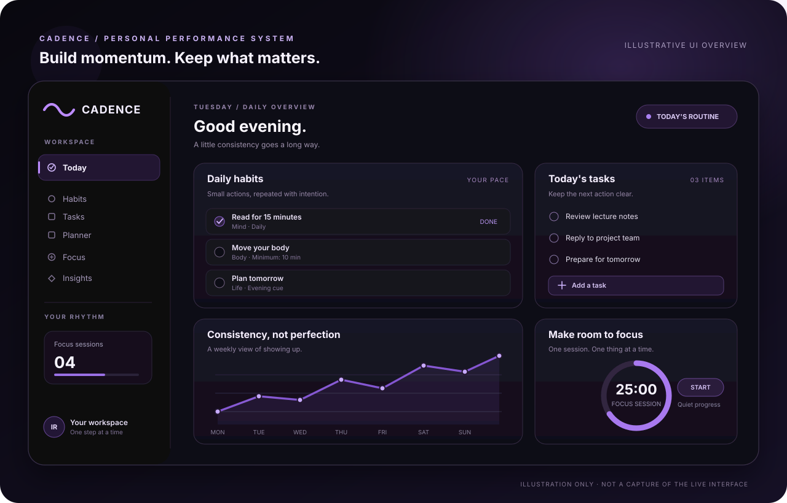

<p align="center">
  
</p>

<p align="center">
  
</p>

<h3 align="center">Build momentum. Keep what matters.</h3>

<p align="center">
  A considered, research-informed space for building habits, managing daily work, and making steady progress.
</p>

<p align="center">
  <a href="https://cadence-elite.vercel.app"><strong>Open the live app ↗</strong></a>
  &nbsp; · &nbsp;
  <a href="#features">Explore features</a>
  &nbsp; · &nbsp;
  <a href="#get-started">Run locally</a>
</p>

<p align="center">
  <a href="https://github.com/ishanraychaudhuri2025/Cadence/actions/workflows/ci.yml"></a>
  
  
  
  <a href="LICENSE"></a>
</p>

---

## Product overview

<p align="center">
  <a href="https://cadence-elite.vercel.app">
    
  </a>
</p>

<p align="center"><sub>Illustrative visual overview — not a screenshot of the live interface. Open Cadence to explore the current product.</sub></p>

Cadence brings routines, recurring tasks, calendar planning, focus sessions, and progress insights into one personal workspace. Its design principle is simple: make the next useful action clear, keep the starting step small, and treat consistency as feedback—not a judgment.

## Features

| Area | What it does |
| --- | --- |
| **Today** | Review the day's routines, completion progress, current and best streaks, and priority tasks. |
| **Habits** | Build routines with a category, cadence, cue, minimum version, and reminder settings. Supports daily, weekday/weekend, weekly, and custom schedules. |
| **Tasks & Planner** | Manage one-off and recurring tasks, review a weekly or monthly calendar, and track individual occurrences. |
| **Focus** | Use a 15 / 25 / 50-minute session, pause or reset a timer, and track completed focus sessions. |
| **Insights** | Review completion trends, activity history, habit consistency, routine rankings, and behavior-design reflections. |
| **Personal reminders** | Configure supported Spotify or YouTube links or upload an audio file up to 20 MB. Uploaded audio is kept in browser memory for the current session; linked soundtracks can sync with the workspace. |
| **Notifications** | Use browser notifications and the push-notification flow on supported devices. Browser permissions, background execution, and audio autoplay vary by browser and operating system. |
| **Account & sync** | Sign in with email/password and sync habits, tasks, focus counts, and appearance preferences to a user-scoped Supabase workspace. |
| **Fresh start** | New workspaces start without demo habits, tasks, completion history, or focus statistics. |
| **Responsive interface** | Dark, violet-accented visual system with desktop navigation, mobile layouts, readable controls, and reduced-motion support. |

## Design principles

Cadence is designed around practical behavior-design principles rather than streak pressure:

- **Make the next action obvious.** Keep the cue and next step close to the habit.
- **Lower the starting cost.** A minimum version makes it easier to begin on low-energy days.
- **Use context intentionally.** Tie actions to repeatable moments such as after breakfast or before closing a laptop.
- **Make progress visible.** Check-ins and history help users notice patterns without treating a missed day as failure.
- **Avoid universal habit timelines.** Automaticity varies across people, behaviors, and contexts; Cadence does not promise that every habit forms in 21 days.

These principles are informed by published behavior research. They are product-design hypotheses, not a claim that Cadence itself has been clinically tested.

### Research starting points

- **[Fogg Behavior Model — Stanford Behavior Design Lab](https://behaviordesign.stanford.edu/resources/fogg-behavior-model):** behavior is more likely when motivation, ability, and a prompt converge.
- **[Harkin et al. (2016)](https://doi.org/10.1037/bul0000025), _Does monitoring goal progress promote goal attainment?_:** meta-analysis of 138 studies and 19,951 participants reporting a positive average effect of progress monitoring on goal attainment.
- **[Gollwitzer & Sheeran (2006)](https://doi.org/10.1016/S0065-2601(06)38002-1), _Implementation Intentions and Goal Achievement_:** evidence on planning actions using concrete “if–then” cues.
- **[Lally et al. (2010)](https://doi.org/10.1002/ejsp.674), _How are habits formed?_:** habit automaticity follows individual trajectories rather than a universal timetable.
- **[Neal, Wood & Quinn (2006)](https://doi.org/10.1111/j.1467-8721.2006.00435.x), _Habits—A Repeat Performance_:** how stable contexts can trigger repeated actions.

See [docs/PROBLEM_SOLUTION_MAP.md](docs/PROBLEM_SOLUTION_MAP.md) for the problem-to-feature map and further references.

## Technology

- **Frontend:** React 19, TypeScript, Vite 7, Lucide icons, custom CSS.
- **Authentication and data:** Supabase Auth and PostgreSQL with Row Level Security (RLS).
- **Reminders:** browser notification/audio support, service worker, and a Supabase Edge Function for push-related server work.
- **Quality checks:** GitHub Actions runs dependency auditing, Node tests, Deno type-checking, TypeScript checks, Vercel configuration validation, and a production build.

## Get started

### Requirements

- Node.js **20.19+** (Node 22 LTS recommended)
- npm

### Install and run

```bash
git clone https://github.com/ishanraychaudhuri2025/Cadence.git
cd Cadence
npm ci
npm run dev
```

Open the local URL printed by Vite (typically `http://localhost:5173`).

### Environment configuration

Cloud authentication and sync require these variables in a local `.env` file and in each deployment environment:

```dotenv
VITE_SUPABASE_URL=https://YOUR_PROJECT_REF.supabase.co
VITE_SUPABASE_PUBLISHABLE_KEY=YOUR_PUBLISHABLE_KEY
```

The app also accepts the legacy `VITE_SUPABASE_ANON_KEY` variable. Use a **publishable/anon** key only in the browser. Never place a Supabase service-role key or another secret in a `VITE_*` variable or commit it to source control.

The Supabase client intentionally has no hard-coded production fallback: if the required configuration is absent, cloud authentication stays disabled rather than silently connecting to the production project.

### Validate a change

Run the same core checks used by CI:

```bash
npm ci
npm audit --audit-level=high
node --test tests/*.test.mjs
npx deno check --no-lock supabase/functions/cadence-push/index.ts
npm run typecheck
npm run build
npm run preview
```

`npm run preview` serves the built app locally after `npm run build`.

## Supabase setup and security

The application stores a signed-in user's workspace in a row protected by PostgreSQL RLS using `auth.uid()`. Push-related tables are restricted to server-side access; they are not meant to be opened up to browser roles simply to silence an advisor warning.

The repository tracks the workspace, notification, grant-hardening, RLS, and `pg_net` maintenance migrations under `supabase/migrations/`. The latest tracked security migrations:

- `20261019040302_harden_tracker_workspace_grants.sql`
- `20261019041017_harden_cadence_push_table_grants.sql`
- `20261019051602_harden_phase3_security_and_pg_net.sql`
- `20261019052019_realign_pg_net_request_sequence.sql`

The `pg_net` maintenance migration moves the extension to the `extensions` schema without `CASCADE`, preserves historical HTTP response diagnostics, and restores the scheduled push job. The sequence follow-up keeps new request IDs beyond retained response IDs. Review migration contents and your target project's state before applying these changes to another database.

### Auth URL configuration

In [Supabase Auth → URL Configuration](https://supabase.com/dashboard/project/wxyigvitegdnurimmarb/auth/url-configuration), set the Site URL to:

```text
https://cadence-elite.vercel.app
```

Allow this exact production origin for confirmation and password-reset redirects. Add preview or local-development URLs only when you actively use those environments, and keep the allowlist scoped to known origins. Verify the hosted values in the dashboard before enabling public sign-ups.

**Production note:** Supabase's Security Advisor has reported leaked-password protection disabled for the current project. Check [Supabase password security](https://supabase.com/docs/guides/auth/password-security#password-strength-and-leaked-password-protection) and your plan's feature availability before launching to a broader audience.

## Repository layout

```text
.
├── public/                    # App icon, wordmark, manifest, service worker
├── src/
│   ├── components/            # Authentication and reusable UI
│   ├── lib/                   # Supabase client and reminder helpers
│   ├── App.tsx                # Main workspace
│   ├── Planner.tsx            # Calendar and recurring-task planner
│   └── TasksPage.tsx          # Task overview
├── docs/
│   ├── cadence-product-overview.svg
│   └── PROBLEM_SOLUTION_MAP.md
├── scripts/                   # Local GitHub publishing helper
├── supabase/
│   ├── functions/cadence-push/
│   ├── migrations/
│   └── tests/                 # SQL account-isolation checks
└── tests/                     # Node regression tests
```

## License

Released under the [MIT License](LICENSE). Third-party packages retain their respective licenses.
